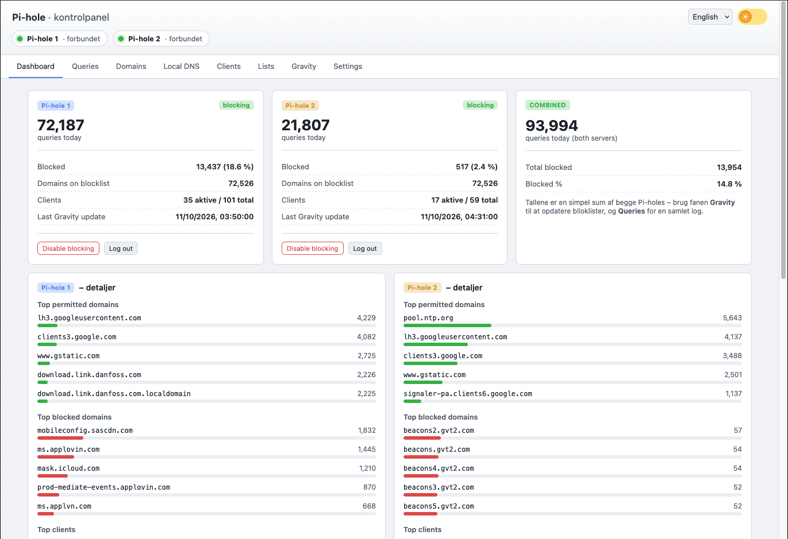

# Doppel-Pi-hole-Dashboard

[English](README.md) | [Dansk](README.DA.md) | **Deutsch**

Ein schlankes Dashboard zur gemeinsamen Verwaltung von zwei, drei oder vier
Pi-hole-v6-Instanzen. Der Browser lädt `index.html`, eine externe
JSON-Konfiguration und eine lokale Chart.js-Datei. Ein Anwendungsbackend,
eine Datenbank oder ein Frontend-Build-Prozess sind nicht erforderlich.
Die Instanzen werden in einer zentralen JSON-Datei konfiguriert. Ein kleines
Python-Werkzeug erzeugt daraus die öffentliche Browserkonfiguration und
nginx-Proxy-Routen. Unter Docker und beim nativen Proxmox-LXC-Dienst geschieht
dies automatisch beim Start.

Das Dashboard bietet:

- Zusammengefasste Statistiken und Diagramme
- Ein gemeinsames Abfrageprotokoll mit Filter- und Sortierfunktionen
- Verwaltung erlaubter und gesperrter Domains
- Lokale DNS-Einträge mit übersichtlicher Anzeige der Unterschiede zwischen den Instanzen
- Bekannte Clients und Vorschläge für unbekannte Geräte
- Verwaltung von Sperr- und Freigabelisten (Adlists)
- Gravity-Aktualisierung pro Instanz mit Anzeige des letzten Aktualisierungszeitpunkts
- Aktionen für eine einzelne oder alle aktiven Instanzen
- Eine dänische, englische und deutsche Benutzeroberfläche

Die Pi-hole-Instanzen bleiben eigenständige DNS-Server. Das Projekt stellt
weder Failover noch eine virtuelle IP-Adresse, einen primären oder sekundären
Server oder eine automatische Replikation im Hintergrund bereit. Ziel ist es,
die relevanten Einstellungen bequem über ein gemeinsames Dashboard
einheitlich zu verwalten.



## Aktueller Stand und Dokumentation

**Geprüft am 18.10.2026:** Die aktuelle Anwendungsversion ist **1.5.009**.
Externe Konfiguration, Docker-Betrieb, der native LXC-Installer und der Schutz
vor API-/Login-Weiterleitungen sind auf `main` umgesetzt. Das
[Roadmap-Issue #6](https://github.com/Daniel-Dietz/dobbelt-pi-hole/issues/6)
führt die verbleibenden Arbeiten und ihre Abnahmekriterien; die
[Roadmap weiter unten](#roadmap) übernimmt diese Reihenfolge.

Die Installation erfolgt derzeit aus einer lokalen Repository-Kopie, bei
Docker mit einem lokal gebauten Image. Versionierte Release-Artefakte und
veröffentlichte Images sind in
[#17](https://github.com/Daniel-Dietz/dobbelt-pi-hole/issues/17) geplant.
Die reale Installations- und Wiederherstellungsabnahme auf Proxmox bleibt in
[#24](https://github.com/Daniel-Dietz/dobbelt-pi-hole/issues/24) offen.

| Anleitung | Inhalt |
| --- | --- |
| Diese README | Funktionen, [Docker](#einrichtung-mit-docker), [Proxmox LXC](#automatische-installation-in-proxmox-lxc), [manuelles nginx](#manuelle-einrichtung-mit-nginx), aktuelle Grenzen und Roadmap |
| [Konfiguration](docs/CONFIGURATION.md) | JSON-Felder, API-Berechtigungen, erzeugte Routen, TLS, Konfigurationsänderungen und Migration |
| [LXC-Installation und Betrieb](docs/LXC.md) | Host-Voraussetzungen, CLI-Optionen, Dienstbefehle, Fehleranalyse, Backup und Wiederherstellung |
| [Übersetzungen und Frontend-Prüfungen](docs/I18N.md) | Sprachkataloge, zusätzliche Sprachen, Unit- und Browsertests |
| [Entwicklung](docs/DEVELOPMENT.md) | Quellcode-Aufbau, lesbarer Code, englische Funktionsdokumentation und Testgruppen |

Die ausführlichen Anleitungen unter `docs/` sind auf Englisch. Alle drei READMEs
beschreiben Installation, aktuellen Stand und Issue-Roadmap in ihrer jeweiligen
Sprache.

## Architektur und Betriebsarten

Das Dashboard ist bewusst einfach aufgebaut:

- Eine HTML-Datei mit HTML, CSS und JavaScript
- Kein Anwendungsbackend
- Keine Datenbank
- Kein Frontend-Build-Prozess
- Python für die Installation und zum Erzeugen der Konfiguration bei Installation oder Dienststart
- Serveradressen, Anzahl, Standardnamen und Standardsprache in einer externen JSON-Datei
- Eigene Namen und Anzeigeeinstellungen lokal im Browser
- Direkte Kommunikation mit den Pi-hole-v6-APIs über nginx

Chart.js wird als separate lokale Datei eingebunden und ausschließlich für
die Diagramme verwendet.

**nginx ist in allen drei Betriebsarten der Webserver und Pi-hole-API-Proxy.**
Du öffnest das Dashboard in deinem eigenen Browser; in Docker oder LXC läuft
kein Browser. Python übernimmt die Bereitstellung und Konfigurationserzeugung.
Node.js und Playwright werden als Entwicklungswerkzeuge für Tests verwendet.

| Betriebsart | Anwendungsdienst | Standardadresse des Dashboards |
| --- | --- | --- |
| Docker Compose | nginx im Container; Image wird aus dieser Repository-Kopie gebaut | Docker-Host `127.0.0.1:8080` |
| Natives Proxmox LXC | nginx unter `dobbelt-pi-hole.service` in einem Debian-13-CT | IPv4-Adresse des CTs, Port `8080` |
| Manuelles nginx | Eigener nginx-Dienst mit erzeugter Konfiguration | `127.0.0.1:8080` mit dem Beispielbefehl weiter unten |

Das Dashboard verwaltet vorhandene Pi-hole-Instanzen. Seine Installation
installiert keinen Pi-hole und ändert nicht die DNS-Server, die deine
Netzwerkclients verwenden.

## Voraussetzungen

- Zwei bis vier Pi-hole-Instanzen der Version **v6** mit REST-API. Das Dashboard
  funktioniert nicht mit der alten PHP-API von Pi-hole v5.
- Docker mit Compose, **Proxmox VE 9 auf amd64** für den automatischen LXC-Installer
  oder nginx und Python ab Version 3.10 für die manuelle Installation.
- Netzwerkzugriff vom nginx des Dashboards auf alle konfigurierten Pi-hole-APIs.
- Ein App-Passwort für jede Pi-hole-Instanz. Dieses wird in der jeweiligen
  Pi-hole-Verwaltungsoberfläche unter **Settings → API** erstellt.

Eine erfolgreiche Anmeldung mit App-Passwort erlaubt nicht jede Änderung.
Lokale DNS-Einträge nutzen geschützte Konfigurationsendpunkte und können trotz
weiterhin gültigen Lesezugriffs mit HTTP 403 abgelehnt werden.
`webserver.api.app_sudo` ist standardmäßig deaktiviert. Eine Aktivierung
erteilt App-Passwort-Sitzungen weitreichende Konfigurationsrechte, auch für
Upstream-DNS, DHCP und Passwörter. Prüfe die
[API-Berechtigungen](docs/CONFIGURATION.md#pi-hole-api-permissions) und nutze
für eingeschränkte Änderungen vorzugsweise die eigene Pi-hole-Verwaltung.
Das Dashboard erweitert Berechtigungen niemals automatisch.

## Einrichtung mit Docker

Lade das Repository herunter und bereite die Konfiguration vor:

```bash
git clone https://github.com/Daniel-Dietz/dobbelt-pi-hole.git
cd dobbelt-pi-hole
cp config/config.example.json config/config.json
```

Trage in `config/config.json` die Namen und API-Adressen deiner zwei bis vier
Instanzen ein und starte anschließend das Dashboard:

```bash
docker compose up --build -d
docker compose logs dashboard
```

Öffne **http://localhost:8080** und melde dich mit dem jeweiligen App-Passwort
bei jeder aktiven Pi-hole-Instanz an. Compose bindet den Port standardmäßig
nur an die Loopback-Adresse des Docker-Hosts. Verwende einen HTTPS-Reverse-Proxy
auf diesem Host oder passe die Portbindung in `compose.yaml` bewusst an,
wenn das Dashboard direkt im lokalen Netzwerk erreichbar sein soll.
[nginx.conf.DE.example](nginx.conf.DE.example) zeigt einen optionalen
vorgeschalteten HTTPS-Proxy.

Das Verzeichnis `./config` wird unter `/config` schreibgeschützt eingebunden.
Beim Start prüft der Container `/config/config.json`, erzeugt beide
Konfigurationen und prüft nginx, bevor der Dienst startet. Bei fehlender oder
ungültiger Konfiguration bricht der Start ab. Chart.js ist im Image enthalten;
beim Start werden keine externen Dateien heruntergeladen.

Starte den Container nach Änderungen an der Konfiguration neu und lade den
Dashboard-Tab erneut:

```bash
docker compose restart dashboard
```

## Automatische Installation in Proxmox LXC

Der Installer erstellt einen neuen **unprivilegierten Debian-13-LXC** und
installiert nginx, Python, das Dashboard sowie Chart.js direkt darin. Er wird
als **root auf dem Proxmox-VE-9-Host** ausgeführt. Die Anwendung läuft anschließend
als eigener Benutzer `dobbelt-pi-hole` im CT; Docker ist dafür nicht erforderlich.

### 1. Projekt und Pi-hole-Konfiguration vorbereiten

Lege eine vollständige lokale Kopie des Projekts auf dem Proxmox-Host ab.
Mit installiertem Git kannst du sie so herunterladen:

```bash
git clone https://github.com/Daniel-Dietz/dobbelt-pi-hole.git /root/dobbelt-pi-hole
cd /root/dobbelt-pi-hole
cp config/config.example.json config/config.json
```

Bearbeite `config/config.json` und trage die Namen und API-Adressen deiner
zwei bis vier Pi-hole-Instanzen ein. App-Passwörter gehören nicht in diese
Datei; du gibst sie später im Dashboard ein. Die
[Konfigurationsanleitung](docs/CONFIGURATION.md) erläutert alle Felder.

### 2. Installation zunächst prüfen

Passe `local-lvm`, `local` und `vmbr0` an die vorhandenen Speicher und die
aktive Bridge deines Proxmox-Nodes an. Prüfe den Plan mit:

```bash
python3 tools/create_lxc.py \
  --config /root/dobbelt-pi-hole/config/config.json \
  --storage local-lvm \
  --template-storage local \
  --bridge vmbr0 \
  --hostname dobbelt-pi-hole \
  --dry-run
```

`--dry-run` prüft die lokalen Dateien und das Proxmox-Inventar und zeigt die
geplanten Befehle. Es erstellt keinen CT, lädt nichts herunter und ändert
nichts am Host. Die automatische Template-Auswahl benötigt einen vorhandenen
Proxmox-Katalog. Falls dieser leer ist, aktualisiere ihn separat mit
`pveam update` und wiederhole die Prüfung.

### 3. Neuen CT erstellen und Anwendung installieren

Starte die Installation mit denselben Parametern ohne `--dry-run`:

```bash
python3 tools/create_lxc.py \
  --config /root/dobbelt-pi-hole/config/config.json \
  --storage local-lvm \
  --template-storage local \
  --bridge vmbr0 \
  --hostname dobbelt-pi-hole
```

Standardmäßig verwendet der Installer eine clusterweit freie CT-ID, das neueste
Debian-13-Standard-Template für amd64 aus dem Proxmox-Katalog und DHCP. Vorgesehen
sind **1 CPU-Kern, 512 MiB RAM, 0 MiB Swap und 4 GiB Speicher**. Bei der echten
Installation wird der Template-Katalog aktualisiert; das gewählte Template
wird nur heruntergeladen, wenn es noch nicht im Cache liegt.

Sobald Befehle im CT möglich sind, wartet der Installer bis zu **180 Sekunden**
auf eine nutzbare bzw. die konfigurierte IPv4-Adresse an `eth0`, DNS-Auflösung
für `deb.debian.org` und `raw.githubusercontent.com` sowie eine TCP-Verbindung
zu `cdnjs.cloudflare.com:443`. Erst danach folgen Dateiübertragung und
Paketinstallation. Bei einem Timeout bleiben der neue CT und sein Löschschutz
erhalten; automatischer Start bleibt aus und der Installer versucht, den CT zu
stoppen. Prüfe dann DHCP bzw. statische Adresse, Gateway, DNS und Firewallregeln.

Weitere Angaben kannst du an den Aufruf anhängen:

| Parameter | Beispiel und Bedeutung |
| --- | --- |
| `--ctid` | `--ctid 123` verwendet eine bestimmte freie CT-ID. |
| `--ipv4` und `--gateway` | `--ipv4 192.168.1.50/24 --gateway 192.168.1.1` setzt eine statische Adresse. |
| `--vlan` | `--vlan 123` setzt das VLAN-Tag. |
| `--nameserver` | `--nameserver 192.168.1.1` legt einen DNS-Server fest; für mehrere Server wiederholen. |
| `--cores`, `--memory`, `--swap`, `--disk` | Ändern CPU-Kerne, RAM/Swap in MiB und Speicher in GiB. |
| `--template` | Wählt ein vorhandenes Template auf `--template-storage` über seine vollständige Proxmox-Volume-ID. |

Der Installer verändert keine bestehenden CTs und baut weder das Host-Netzwerk
noch Firewallregeln um. Automatischer CT-Start beim Booten wird erst nach
erfolgreicher Installation aktiviert. Bei einem Fehler bleibt der neue CT zur
Diagnose erhalten, zunächst ohne automatischen Start. Der Installer ist für
**Neuinstallationen** vorgesehen und enthält keinen Updater für bestehende CTs.
Auch vorhandene nginx-Pakete, Dienste, Maskierungen oder Konfigurationen im Gast
führen vor Änderungen zum Abbruch. Verwende ein frisches Debian-13-Standard-Template;
ein bereits vorhandener Webserver wird nicht übernommen.
Der CT erhält außerdem einen Löschschutz (`protection=1`), der auch nach Erfolg
oder Fehler aktiv bleibt. Für ein bewusstes späteres Entfernen musst du ihn
zuerst mit `pct set 123 --protection 0` aufheben; ersetze `123` durch die zuvor
geprüfte CT-ID. Der Installer löscht selbst keine CTs.

### 4. Dashboard öffnen und betreiben

Der native Dienst lauscht auf **`0.0.0.0:8080` innerhalb des CT**. Verwende die
am Ende ausgegebene CT-Adresse, beispielsweise `http://192.168.1.50:8080`.
Für den regulären Zugriff empfiehlt sich ein vorgeschalteter HTTPS-Proxy mit
geeigneter Zugriffsbeschränkung. Die Aktivierung des Firewallflags am
CT-Netzwerkadapter erzeugt **keine fertigen Firewallregeln**.

Läuft dein HTTPS-Proxy außerhalb des CT, ersetzt du im
[nginx-Beispiel](nginx.conf.DE.example) das Ziel `127.0.0.1:8080` durch die
CT-Adresse, beispielsweise `192.168.1.50:8080`. Beschränke den Zugriff auf
CT-Port 8080 mit deiner vorhandenen Proxmox-Firewall auf den Proxy bzw. die
vorgesehenen vertrauenswürdigen Clients. Die Pi-hole-Adressen bleiben
weiterhin ausschließlich in der zentralen JSON-Datei.

Diese Datei liegt nach der Installation **im CT** unter
`/etc/dobbelt-pi-hole/config.json`. Die ursprüngliche Kopie auf dem Host wird
nicht laufend synchronisiert. Mit `pct enter 123` öffnest du eine Shell im CT;
ersetze `123` durch die ausgegebene CT-ID. Nach einer Konfigurationsänderung
kannst du den Dienst vom Proxmox-Host aus neu starten und seine Logs anzeigen:

```bash
pct exec 123 -- systemctl restart dobbelt-pi-hole
pct exec 123 -- journalctl -u dobbelt-pi-hole -n 100 --no-pager
```

Lade anschließend den Dashboard-Tab neu. Chart.js und dessen Lizenz werden bei
der Installation heruntergeladen und per SHA-256 geprüft; Dienststarts brauchen
keine erneuten Downloads. Der [LXC-Leitfaden](docs/LXC.md) (auf Englisch) enthält
die vollständige Parameterübersicht sowie Hinweise zu Backup, Wiederherstellung,
Updates und Fehlerbehebung.

## Manuelle Einrichtung mit nginx

1. Kopiere `index.html` in das Webverzeichnis, beispielsweise
   `/srv/web/pihole-dashboard/index.html`, und lade Chart.js daneben herunter:

   ```bash
   curl --fail --location -o /srv/web/pihole-dashboard/chart.umd.min.js \
     https://cdnjs.cloudflare.com/ajax/libs/Chart.js/4.4.1/chart.umd.min.js
   ```

2. Kopiere [config/config.example.json](config/config.example.json) an einen
   privaten Speicherort wie `/etc/dobbelt-pi-hole/config.json` und passe Namen
   und API-Adressen an. Diese Quelldatei gehört außerhalb des Webverzeichnisses.
3. Erzeuge die öffentliche Konfiguration und die nginx-Routen aus derselben Datei:

   ```bash
   python3 tools/render_config.py \
     --config /etc/dobbelt-pi-hole/config.json \
     --output-dir /etc/nginx/dobbelt-pi-hole \
     --web-root /srv/web/pihole-dashboard \
     --listen-address 127.0.0.1
   ```

4. Ergänze im vorhandenen `http`-Block von nginx die Zeile
   `include /etc/nginx/dobbelt-pi-hole/nginx.conf;`. Der erzeugte Server lauscht
   auf `127.0.0.1:8080`. [nginx.conf.DE.example](nginx.conf.DE.example) dient bei Bedarf
   als vorgeschalteter HTTPS-Proxy; passe Domain und Zertifikatspfade an.
5. Prüfe die Konfiguration und lade nginx neu. Öffne anschließend das Dashboard
   und melde dich an:

   ```bash
   nginx -t && systemctl reload nginx
   ```

Führe nach Änderungen an der JSON-Datei oder `index.html` den Generator erneut
aus und lade nginx neu; die erzeugte Content Security Policy verwendet Hashwerte
der eingebetteten Skripte. Die [Konfigurationsanleitung](docs/CONFIGURATION.md) (auf Englisch)
erläutert alle Felder, TLS, Dateiberechtigungen und die Migration älterer Installationen.

## Serveranzahl und Namen

**`config.json` ist die einzige Quelle für die Instanzkonfiguration.** Das Array
`servers` enthält zwei, drei oder vier Objekte mit einer festen `id` (`"1"` bis
`"4"`), `label` und `apiUrl`. Seine Länge bestimmt die Anzahl der Server,
seine Reihenfolge die Anzeigereihenfolge. Für HTTPS-Verbindungen zu Pi-hole
ist `verifyTls` standardmäßig `true`. Siehe
[Beispieldatei](config/config.example.json) und [JSON-Schema](config/config.schema.json).

Trage bei `apiUrl` die direkte, endgültige Basis-URL der Pi-hole-v6-API ein,
mit passendem Schema (`http` oder `https`), Hostnamen, Port und API-Pfad.
Anmelde- und API-Anfragen folgen absichtlich keinen HTTP-Weiterleitungen.
Eine Anfrage, die eine Weiterleitung benötigt, schlägt fehl. Korrigiere in
diesem Fall die URL in der Konfiguration und übernimm die Änderung, bevor du
es erneut versuchst.

Die Serverfarben sind an die IDs gebunden: Blau, Gelb, Violett und Orange.
Das Layout passt sich an die Serveranzahl und Bildschirmbreite an, bis zu
maximal 1900 Pixeln Seitenbreite. Die API-Routen werden automatisch erzeugt;
es gibt keine zweite Liste von Pi-hole-Adressen in nginx oder HTML zu pflegen.

Namen lassen sich außerdem unter **Einstellungen** ändern. Sie werden im
`localStorage` des Browsers gespeichert und ersetzen dort die konfigurierten
Standardnamen. **Standardnamen wiederherstellen** übernimmt die aktuellen
Vorgaben aus der Datei. Anzahl und Adressen der Instanzen werden in der
JSON-Datei verwaltet. Eine Weboberfläche zum Bearbeiten dieser zentralen
Konfiguration mit lokalem JSON-Import und -Export ist in
[#19](https://github.com/Daniel-Dietz/dobbelt-pi-hole/issues/19) geplant.
Geschütztes Speichern und Anwenden auf dem Server folgt als separates
Arbeitspaket [#20](https://github.com/Daniel-Dietz/dobbelt-pi-hole/issues/20).

Beim Upgrade von v1.3.007 oder älter überträgst du die Instanzangaben aus HTML
und nginx in die JSON-Datei und ersetzt die bisherigen API-Proxy-Blöcke durch
die erzeugte Konfiguration. Vorhandene lokale Anzeigenamen werden übernommen;
pro Instanz ist jedoch eine **einmalige erneute Anmeldung** erforderlich,
weil Sitzungen jetzt an das konfigurierte API-Ziel gebunden sind. Ändert sich
später eine API-Adresse, meldet ein alter Tab die Konfigurationsänderung und
muss vor weiteren Anfragen neu geladen werden. Umbenennen oder Umsortieren
derselben Instanzen ändert ihre API-Identität nicht.

## Sprachen

Die Benutzeroberfläche ist auf **English**, **Dansk** und **Deutsch**
verfügbar. Die Sprachauswahl oben im Dashboard stellt die Oberfläche sofort
um, einschließlich Dialogtexten, dynamischen Meldungen, Tabellen und
Diagrammen. Zahlen, Prozentwerte, Datum und Uhrzeit werden entsprechend der
ausgewählten Sprache formatiert.

Beim Öffnen wird die Sprache in dieser Reihenfolge ermittelt:

1. Eine unterstützte Sprache, die zuvor im Browser ausgewählt und im
   `localStorage` gespeichert wurde.
2. Die konfigurierte `defaultLanguage`, sofern sie `da`, `en` oder `de` ist.
   Der Standardwert `auto` führt weiter zur Sprachauswahl des Browsers.
3. Die erste unterstützte Sprache aus der nach Präferenz sortierten
   Sprachliste des Browsers. Regionale Varianten wie `de-DE`, `de-AT`,
   `en-GB` und `da-DK` werden unterstützt.
4. Englisch, falls keine unterstützte Sprache gefunden wird.

Die Übersetzungen verwenden feste Nachrichtenschlüssel und benannte
Parameter in vollständigen `en`-, `da`- und `de`-Sprachkatalogen direkt in
`index.html`. Zusätzliche Sprachen benötigen weder Backend noch Build-Schritt
oder weitere Laufzeitabhängigkeiten. Servernamen, Domains, Clientnamen,
Kommentare und andere von Benutzern oder den Pi-hole-APIs gelieferte Werte
bleiben beim Sprachwechsel unverändert.

Die READMEs enthalten Einrichtungsanleitungen in allen drei Sprachen. Kommentare
und Funktionsdokumentation in Quellcode, Codebeispielen und nginx-Beispielen
sind immer auf Englisch. Die unten verlinkten nginx-Beispieldateien haben
identischen Inhalt; ihre bisherigen Dateinamen bleiben für bestehende
Dokumentationslinks erhalten.

| Sprache | Dokumentation | nginx-Beispiel |
| --- | --- | --- |
| English | [README.md](README.md) | [nginx.conf.example](nginx.conf.example) |
| Dansk | [README.DA.md](README.DA.md) | [nginx.conf.DA.example](nginx.conf.DA.example) |
| Deutsch | [README.DE.md](README.DE.md) | [nginx.conf.DE.example](nginx.conf.DE.example) |

## Aktuelle Grenzen im Betrieb

- **Aktionen über mehrere Instanzen:** Jede Pi-hole-Instanz wird unabhängig
  angesprochen; es gibt keine gemeinsame Transaktion und keine automatische
  Rücknahme. Domains, lokale DNS-Einträge, Clients und Listen unterscheiden
  bestätigte Änderungen, Ablehnungen, nicht verbundene Ziele und unbekannte
  Schreibausgänge. Vor dem Schreiben wird der aktuelle Zustand je Ziel
  abgefragt. Fehlgeschlagene Lesezugriffe gelten nicht als fehlende Einträge,
  und bei unvollständigem Ergebnis bleiben Eingaben erhalten. Nach einer
  verlorenen Antwort muss der Zustand vor einer bewussten Wiederholung geprüft
  werden; es erfolgt keine automatische Wiederholung. Siehe
  [#8](https://github.com/Daniel-Dietz/dobbelt-pi-hole/issues/8).
- **Anfragen und Browserzustand:** Reguläre API-Aufrufe, Login und Logout
  haben ein Browser-Zeitlimit von 15 Sekunden; die Prüfung gespeicherter
  Sitzungen ist auf 10 Sekunden begrenzt. Für Gravity gilt zunächst die
  reguläre Anfragefrist, anschließend ein Inaktivitätslimit von zwei Minuten
  und ein absolutes Streamlimit von 30 Minuten. Gesunde Pi-hole-Instanzen
  zeigen Status und Query-Zeilen unabhängig von langsamen Gegenstellen;
  Gesamtsummen werden bei fehlenden Antworten als Teildaten gekennzeichnet.
  Zeitraumwechsel und Navigation brechen überholte Query-/Cursor-Abfragen ab.
  HTTP 401 verwirft nur die ursprüngliche Sitzung. Scheitert die Prüfung
  einer wiederhergestellten SID an einem Verbindungsfehler, bleibt die Sitzung
  als unbestätigt gespeichert und kann manuell erneut geprüft werden.
  Transportfehler gewöhnlicher API-Aufrufe bewahren die SID, ändern aber
  einen bereits bestehenden Verbindungsstatus nicht. Logout löscht sie sofort
  lokal und unterscheidet bestätigten und unbestätigten Remote-Widerruf. Details stehen in der englischen
  [Betriebsanleitung](docs/CONFIGURATION.md#browser-request-limits-and-session-state).
  Pi-hole-v6-Berechtigungsfehler, unbekannte Blocking-Zustände und
  ausschließlich lesende Versionsprüfungen werden in
  [#10](https://github.com/Daniel-Dietz/dobbelt-pi-hole/issues/10)
  behandelt. Unvollständige API-Antworten gelten weder als leer noch als
  erfolgreich. Formularentwürfe, Tastaturbedienung und zusätzliche
  Browser-/Mobiltests bleiben in
  [#11](https://github.com/Daniel-Dietz/dobbelt-pi-hole/issues/11).
- **Konfigurationsänderungen:** Beim Start wird das JSON geprüft. Ein Neustart
  mit ungültiger Eingabe kann den Dienst jedoch unerreichbar lassen. Bewahre
  eine funktionierende Kopie der privaten Konfiguration auf. Getrennte
  Vorabprüfung, koordinierte Aktivierung und automatische Wiederherstellung
  sind in [#12](https://github.com/Daniel-Dietz/dobbelt-pi-hole/issues/12) geplant.
- **Überwachung:** `/healthz` bestätigt, dass nginx antwortet; es prüft weder
  die Erreichbarkeit der Pi-holes noch die API-Anmeldung. Ein Diagnosekommando
  ist in [#13](https://github.com/Daniel-Dietz/dobbelt-pi-hole/issues/13) geplant.
  Zusammengefasste Statistiken können bei nicht erreichbaren Instanzen
  unvollständig sein. Sichtbares Datenalter, Vollständigkeit und optionale
  automatische Aktualisierung folgen in
  [#22](https://github.com/Daniel-Dietz/dobbelt-pi-hole/issues/22).
  Der Status eines externen Nebula Sync wird bisher nicht angezeigt; die
  Überwachung ist in [#27](https://github.com/Daniel-Dietz/dobbelt-pi-hole/issues/27)
  geplant.
- **Updates und Wiederherstellung:** Der LXC-Installer erstellt ausschließlich
  neue CTs. Behalte die aktuelle Installation und ihre Backups, während du
  einen Ersatz vorbereitest. Die
  [bisherige Update- und Backup-Anleitung](docs/LXC.md#updates-backup-and-recovery)
  beschreibt den Ablauf. Erprobte Docker-/LXC-Wiederherstellung ist in
  [#18](https://github.com/Daniel-Dietz/dobbelt-pi-hole/issues/18) erfasst, die
  reale Proxmox-Abnahme gesondert in
  [#24](https://github.com/Daniel-Dietz/dobbelt-pi-hole/issues/24).

## Sicherheit

- Das Dashboard ist für den persönlichen Einsatz oder für einen
  vertrauenswürdigen Benutzerkreis vorgesehen. Wer sich anmelden kann, kann
  die von der jeweiligen Pi-hole-Sitzung erlaubten Aktionen ausführen. Das
  Dashboard hat keine eigene Benutzer- oder Rollenverwaltung.
- Anmeldesitzungen werden im `sessionStorage` des Browsers gespeichert und
  beim Schließen des Tabs entfernt. Passwörter werden nicht gespeichert.
- Nicht vertrauenswürdige Werte wie Clientnamen, Domains und Kommentare
  werden vor der Anzeige maskiert.
- nginx erlaubt eingebettete Anwendungsskripte über SHA-256-Hashes in der Content
  Security Policy und lädt Chart.js lokal. Die Antworten enthalten außerdem
  Cachebeschränkungen, Schutz vor Einbettung in Frames und `nosniff`-Header.
- Compose und der native LXC-Dienst führen nginx ohne Rootrechte oder
  Capabilities aus und verhindern eine Rechteerhöhung. Der API-Proxy entfernt
  `Authorization`- und `Cookie`-Header des Browsers vor der Weiterleitung an
  Pi-hole; die Zertifikatsprüfung für HTTPS-Ziele ist standardmäßig aktiv.
- Beim Betrieb auf einem Synology NAS kann ein DSM-Zugriffssteuerungsprofil
  den Zugriff auf bestimmte IP-Adressen oder lokale Netzwerke beschränken.

HTTPS am vorgeschalteten Proxy schützt die Browserverbindung. Eine
HTTP-Verbindung von dort zu einem entfernten LXC-Backend bleibt unverschlüsselt;
die HTTPS-Prüfung für nginx-Verbindungen zu Pi-hole ist wiederum eine eigene
Einstellung. Beschränke den direkten Backend-Zugriff wie in der
[LXC-Netzwerkanleitung](docs/LXC.md#access-and-firewall-placement) beschrieben.
Ein geprüftes geschütztes Betriebsprofil ist in
[#15](https://github.com/Daniel-Dietz/dobbelt-pi-hole/issues/15) erfasst.
Logaufbewahrung und reduzierte Zugriffsprotokolle folgen in
[#14](https://github.com/Daniel-Dietz/dobbelt-pi-hole/issues/14); bisher gilt die
Protokollierungseinstellung des Docker-Hosts, die Journal-/Syslog-Einstellung
des CTs beziehungsweise die vorhandene nginx-Logkonfiguration bei manueller
Installation.

Das Dashboard sollte ohne vorgeschaltete, geeignete Zugriffskontrolle nicht
direkt aus dem Internet erreichbar sein.

## Umgesetzte Meilensteine

Diese Versionen beschreiben umgesetzte Entwicklungsstände. Sie sind kein
Verzeichnis veröffentlichter Release-Artefakte.

- **v1.1.005:** Vollständige dänische und englische Oberfläche und Dokumentation
- **v1.2.006:** Unterstützung für zwei, drei oder vier Pi-hole-Instanzen
- **v1.3.007:** Schlüsselbasierte dänische, englische und deutsche Übersetzungen mit Regressionsprüfungen — [PR #1](https://github.com/Daniel-Dietz/dobbelt-pi-hole/pull/1)
- **v1.4.008:** Externe JSON-Konfiguration, erzeugte API-Routen und lokal baubares Docker-Image — [PR #3](https://github.com/Daniel-Dietz/dobbelt-pi-hole/pull/3)
- **v1.5.009:** Automatische native Proxmox-LXC-Installation, stärkere nginx-Isolierung und CSP — [PR #5](https://github.com/Daniel-Dietz/dobbelt-pi-hole/pull/5)
- **Nachfolgende Korrektur auf `main`:** API- und Login-Weiterleitungen werden abgelehnt — [#7](https://github.com/Daniel-Dietz/dobbelt-pi-hole/issues/7), gemergt mit [PR #25](https://github.com/Daniel-Dietz/dobbelt-pi-hole/pull/25)
- **Mehrinstanz-Zuverlässigkeit auf `main`:** Korrekte Lese-/Schreibergebnisse je Pi-hole, sichere Wiederholungen und erhaltene Client-Entwürfe — [#8](https://github.com/Daniel-Dietz/dobbelt-pi-hole/issues/8), gemergt mit [PR #29](https://github.com/Daniel-Dietz/dobbelt-pi-hole/pull/29).
- **Zuverlässige API-Sitzungen und Query-Ansichten auf `main`:** Begrenzte API- und Gravity-Aufrufe, unabhängige Pi-hole-Ergebnisse und sichere Behandlung veralteter Sitzungen — [#9](https://github.com/Daniel-Dietz/dobbelt-pi-hole/issues/9), gemergt mit [PR #31](https://github.com/Daniel-Dietz/dobbelt-pi-hole/pull/31); [Main-CI](https://github.com/Daniel-Dietz/dobbelt-pi-hole/actions/runs/39106508075) erfolgreich.

## Roadmap

[Roadmap-Issue #6](https://github.com/Daniel-Dietz/dobbelt-pi-hole/issues/6) ist
die maßgebliche Fortschrittsübersicht. **Stand: 18.10.2026 — 3 von 19
Arbeitspaketen abgeschlossen; 16 offen. Als Nächstes: #10.** Die Tabelle folgt
der empfohlenen Bearbeitungsreihenfolge. Nur die Spalte „Voraussetzungen“ nennt
technische Abhängigkeiten innerhalb dieser Roadmap; eine vorherige Zeile ist
nicht automatisch eine Voraussetzung. Umfang und Abnahmekriterien stehen in
den Issues. Künftige Versionsnummern und Liefertermine sind nicht festgelegt.

Die Nebula-Sync-Überwachung (#27) wurde als Arbeitspunkt **16a** nach #22 und
vor #23 ergänzt. Die bisherigen Arbeitspunktnummern bleiben bestehen; #27 ist
keine zusätzliche Voraussetzung für #23 oder #24.

| Reihenfolge | Issue und Umfang | Status | Voraussetzungen |
| --- | --- | --- | --- |
| 01 | [#7](https://github.com/Daniel-Dietz/dobbelt-pi-hole/issues/7) — API-/Login-Weiterleitungen auf andere Instanzrouten verhindern | Abgeschlossen | Keine |
| 02 | [#8](https://github.com/Daniel-Dietz/dobbelt-pi-hole/issues/8) — Lese-/Schreibergebnisse je Instanz, Teilerfolge und unbekannte Datenstände | Abgeschlossen | #7 |
| 03 | [#9](https://github.com/Daniel-Dietz/dobbelt-pi-hole/issues/9) — Anfragefristen, sichere Query-Ladevorgänge und getrennte Sitzungs-/Verbindungszustände | Abgeschlossen | #7, #8 |
| 04 | [#10](https://github.com/Daniel-Dietz/dobbelt-pi-hole/issues/10) — API-Kompatibilität, Berechtigungen sowie fehlgeschlagener/unbekannter Blocking-Status | Offen — als Nächstes | #9 |
| 05 | [#11](https://github.com/Daniel-Dietz/dobbelt-pi-hole/issues/11) — Entwürfe erhalten; Tastatur-, Browser- und Mobilabdeckung verbessern | Offen | #8, #9 |
| 06 | [#12](https://github.com/Daniel-Dietz/dobbelt-pi-hole/issues/12) — Konfiguration vorab prüfen, koordiniert aktivieren und zurücksetzen | Offen | Keine |
| 07 | [#13](https://github.com/Daniel-Dietz/dobbelt-pi-hole/issues/13) — Lesende Diagnose für Konfiguration, Dienst und Verbindungen | Offen | #12 |
| 08 | [#14](https://github.com/Daniel-Dietz/dobbelt-pi-hole/issues/14) — Logaufbewahrung und datensparsame nginx-Zugriffsprotokolle | Offen | Keine |
| 09 | [#15](https://github.com/Daniel-Dietz/dobbelt-pi-hole/issues/15) — Geschützter Netzwerk-/TLS-Betrieb für entfernte LXC-Backends | Offen | #13 |
| 10 | [#16](https://github.com/Daniel-Dietz/dobbelt-pi-hole/issues/16) — Zentrale Abhängigkeitsdaten, feste CI-Referenzen und Update-Prüfungen | Offen | #7 |
| 11 | [#17](https://github.com/Daniel-Dietz/dobbelt-pi-hole/issues/17) — Geprüfte Releases, Docker-Images, native Artefakte und Versionsidentität | Offen | #12, #13, #16 |
| 12 | [#18](https://github.com/Daniel-Dietz/dobbelt-pi-hole/issues/18) — Docker-/LXC-Update, Rollback und portable Wiederherstellung erproben | Offen | #12, #13, #17 |
| 13 | [#19](https://github.com/Daniel-Dietz/dobbelt-pi-hole/issues/19) — Mehrsprachiger lokaler JSON-Konfigurationsassistent mit Import/Export | Offen | #10, #11, #12 |
| 14 | [#20](https://github.com/Daniel-Dietz/dobbelt-pi-hole/issues/20) — Zentrale Konfiguration geschützt auf dem Server speichern/anwenden | Offen | #12, #13, #15, #18, #19 |
| 15 | [#21](https://github.com/Daniel-Dietz/dobbelt-pi-hole/issues/21) — Zeitlich begrenzte Blocking-Pause mit Pi-hole-seitigem Timer | Offen | #8, #9, #10 |
| 16 | [#22](https://github.com/Daniel-Dietz/dobbelt-pi-hole/issues/22) — Datenalter/-vollständigkeit und sparsame optionale automatische Aktualisierung | Offen | #8, #9, #10, #21 |
| 16a | [#27](https://github.com/Daniel-Dietz/dobbelt-pi-hole/issues/27) — Optionale lesende Nebula-Sync-Überwachung mit belegten Lauf- und Replikaergebnissen | Offen | #12, #13, #22 |
| 17 | [#23](https://github.com/Daniel-Dietz/dobbelt-pi-hole/issues/23) — Instanzvergleich, Abgleichvorschau und ausgewählte Änderungen | Offen | #8, #9, #10, #22 |
| 18 | [#24](https://github.com/Daniel-Dietz/dobbelt-pi-hole/issues/24) — Installation und Wiederherstellung auf einem echten Proxmox-Testhost abnehmen | Offen | #12, #13, #15, #17, #18 |

Der lokale Assistent in #19 soll JSON exportieren; die Serveradministration ist
separat in #20 eingeplant. Beides ist in der aktuellen Einstellungsseite noch
nicht vorhanden. Der Instanzabgleich in #23 bleibt eine bewusste Benutzeraktion;
unbeaufsichtigte Replikation und DNS-Failover gehören nicht zum geplanten Umfang.

Die Nebula-Sync-Überwachung in #27 ist als lesende Anbindung eines separat
installierten, konfigurierten und aktivierten Dienstes geplant. Sie erfordert
zusätzlich eine vollständige Dashboard-Konfiguration und ausdrückliche
Aktivierung. Standardmäßig bleibt sie deaktiviert und stellt keine
Statusabfragen. Letzter bestätigter abgeschlossener Erfolg, Datenalter und
Ergebnisse je Replika werden nur bei Nachweis aus der Statusquelle angezeigt;
fehlende Angaben bleiben unbekannt. Fehler nach der Aktivierung bleiben
sichtbar. Die Anbindung startet keine Syncs, verändert keine Konfiguration und
stellt kein Failover bereit.

## Prüfungen

Der [i18n-Workflow](.github/workflows/i18n.yml) prüft Übersetzungsverhalten,
Chromium-Browserabläufe mit Testdaten, Konfigurationserzeugung und
Docker-Integration sowie Proxmox-CLI-Fixtures und die Installation in einem
Debian-13-Systemd-Testcontainer. Diese Prüfungen belegen keine reale
Proxmox-Installation oder Wiederherstellung. Firefox, WebKit und eine gezielte
mobile Smoke-Testmatrix bleiben in #11 offen.

Die Prüfungen ohne zusätzliche Paketabhängigkeiten benötigen Node.js 24 und
Python und werden im Hauptverzeichnis des Repositorys ausgeführt:

```bash
node --test tests/i18n.test.cjs
python3 -m unittest discover -s tests -p 'test_render_config.py' -v
python3 -m unittest discover -s tests -p 'test_create_lxc.py' -v
```

Weitere Voraussetzungen und Befehle stehen bei den
[Browsertests](docs/I18N.md#verification),
[Docker-Integrationsprüfungen](docs/CONFIGURATION.md#upgrading-and-checks) und
[nativen Gastprüfungen](docs/LXC.md#verification-scope). Node.js, npm und
Playwright werden auf einer bereitgestellten Dashboard-Installation nicht
benötigt.

## Mitwirken

Issues und Pull Requests sind willkommen. Mögliche Beiträge sind
Fehlerbehebungen, Vorschläge und Übersetzungen in weitere Sprachen. Verwende
in allen Sprachkatalogen dieselben Nachrichtenschlüssel und benannten
Parameter. Berücksichtige statische Texte, dynamische Zustände und
Beschriftungen für die Barrierefreiheit.
Der [Übersetzungsleitfaden](docs/I18N.md) (auf Englisch) beschreibt die
Hilfsfunktionen, das Hinzufügen weiterer Sprachen und die automatisierten
Prüfungen.

Halte den gepflegten Quellcode mit aussagekräftigen Namen und klaren Abläufen
lesbar. Dokumentiere jede Funktion, auch verschachtelte Callbacks und
Test-Fixtures, direkt an ihrer Definition mit einer hilfreichen englischen
Beschreibung. Der [Entwicklungsleitfaden](docs/DEVELOPMENT.md) (auf Englisch)
erklärt die Dokumentationsregeln, den Quellcode-Aufbau und die Prüfungen.

Prüfe vor jedem Arbeitspaket `main`, das Issue, seine Abhängigkeiten und
vorhandene PRs neu. Folge dem Ablauf in
[#6](https://github.com/Daniel-Dietz/dobbelt-pi-hole/issues/6): jeweils ein
Implementierungs-PR, passende Tests und DA/EN/DE-Anpassungen, Codex-Review des
endgültigen PR-Heads und erfolgreiche CI vor dem Merge. Vor dem Schließen des
Issues folgt der Main-CI-Nachweis. Halte nach einem Abschluss die Roadmaps aller
drei READMEs mit dem Tracker synchron. Eine reine Dokumentationsänderung
schließt kein Funktions-Issue ab.

## Lizenz

Copyright © 2023–2026 Christian Kragh Jessen  
https://christiankragh.dk

Das Projekt wurde ursprünglich 2023 für Pi-hole v5 entwickelt und 2026 für
Pi-hole v6 aktualisiert.

Das Projekt steht unter der MIT-Lizenz und darf gemäß deren Bedingungen
verwendet, kopiert, verändert und weiterverbreitet werden. Siehe `LICENSE`.

Das Docker-Image enthält Chart.js 4.4.1 und dessen MIT-Lizenz unter
`/usr/share/licenses/chart.js/LICENSE`. Der LXC-Installer lädt und prüft die
Diagrammbibliothek und ihre Lizenz ebenfalls automatisch. Bei manueller
Installation wird Chart.js wie oben beschrieben separat heruntergeladen.
Chart.js ist ein unabhängiges Drittanbieterprojekt.
